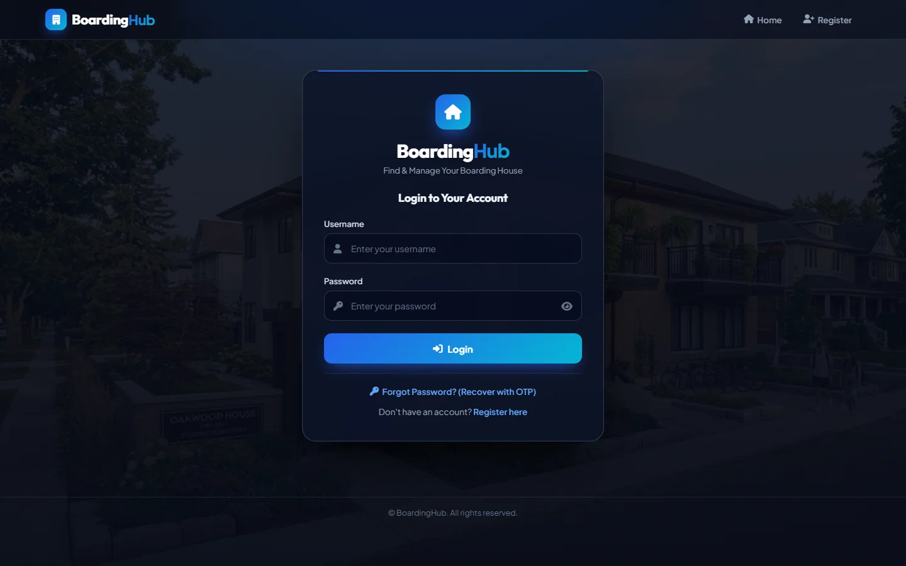

# 🏠 BoardingHub

A boarding house and dormitory finder for students. Boarders can search listings, reserve rooms, save favorites and send maintenance requests, while admins post listings, approve accounts and keep an eye on activity logs.


## Features

**For boarders**

- Search boarding houses and dorms by location, room type and monthly budget, with quick filters (Fast Wi-Fi, Aircon, Female Only, Own CR)
- Reserve rooms and track reservation status from a personal dashboard
- Save favorite boarding houses and submit maintenance requests

**For admins**

- Post boarding houses with a photo, room types, price range, amenities, gender policy and landlord contact details
- Approve or block new accounts and handle account deletion requests
- Review login history and activity logs
- Super admins manage admin roles and fine-grained privileges

**Accounts & security**

- Multi-step registration with real-time validation and Philippine address autocomplete
- Email one-time codes (OTP) for account verification and password recovery
- Security questions, CSRF protection and hashed passwords
- Login lockout after 3 failed attempts, with longer waits on repeated failures
- Accounts created by an admin get a temporary password and finish setup on first login

## Tech stack

PHP · MySQL / MariaDB · JavaScript · HTML · CSS · Font Awesome

## Run it locally (XAMPP)

1. Install [XAMPP](https://www.apachefriends.org/) and start **Apache** and **MySQL**.
2. Copy the `Gymbros-master` folder into `C:\xampp\htdocs\`.
3. Open [phpMyAdmin](http://localhost/phpmyadmin), create a database named **`gym_Bros`**, then import these files from `Gymbros-master/database/` **in this order**:
   1. `gym_Bros (1).sql`
   2. `update_schema.sql`
   3. `boarding_schema.sql`
4. Check the database settings in `Gymbros-master/includes/config.php` (XAMPP default: user `root`, no password).
5. To send OTP emails, fill in the SMTP settings in the same file with your own Gmail address and a [Google App Password](https://myaccount.google.com/apppasswords). **Never commit a real password.**
6. Open <http://localhost/Gymbros-master/php/index.php>.

`update_schema.sql` creates a local super admin account, **`superadmin`** / **`SuperAdmin123!`**. Change its password after your first login.

## Project structure

```
Gymbros-master/
├── php/        Pages: home, login, register, dashboard, admin panel
├── includes/   Config, database connection, auth, security, mailer, OTP
├── js/         Validation, multi-step registration, lockout timer, dashboards
├── css/        Styles and theme
├── database/   SQL schema and updates
└── images/     Hero and listing photos
```

> The folder is named `Gymbros-master` because BoardingHub grew out of an earlier gym management project.

## Screenshots



---

Maintained by **Jimuel Amuto** · [Portfolio](https://jimuel-amuto.vercel.app) · [GitHub](https://github.com/itzJimuel)
